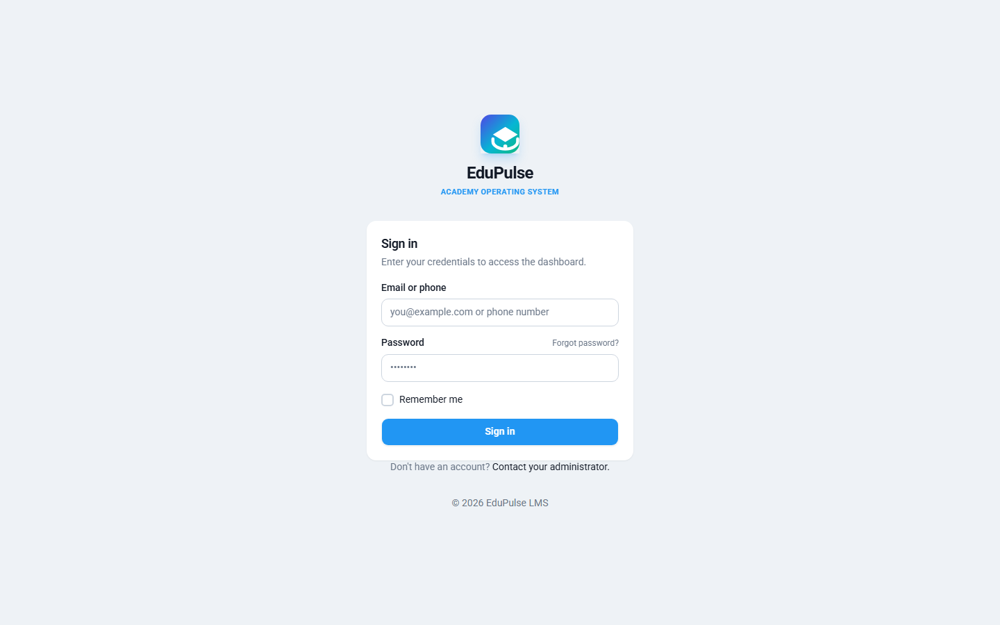
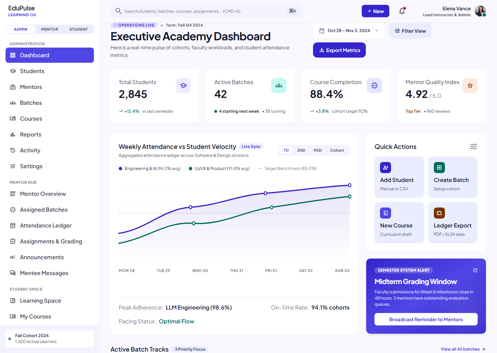
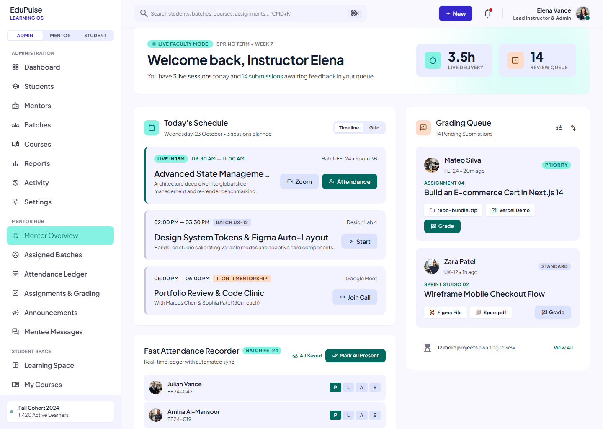
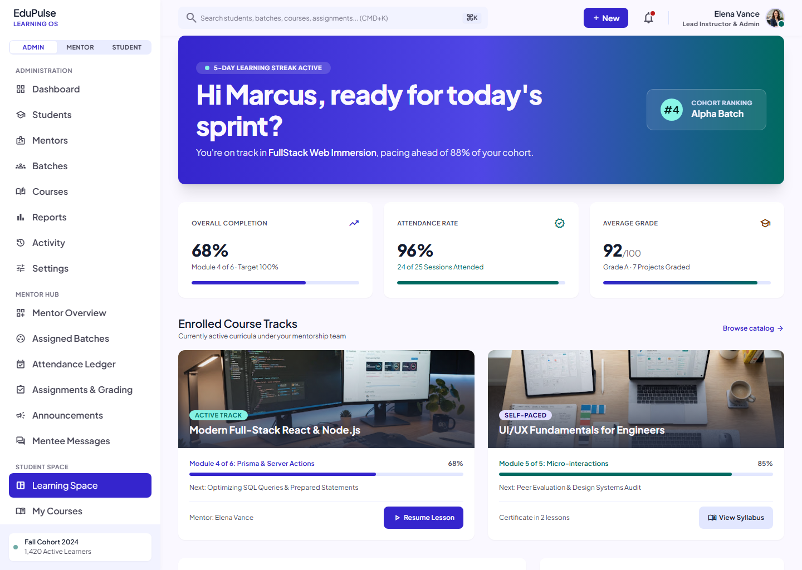

# EduFlow LMS

A modern Learning Management System with role-based dashboards for **Admin**,
**Mentor**, and **Student**.

- **Backend**: Node.js, Express 4, TypeScript, Prisma ORM + MongoDB, JWT auth
- **Frontend**: React 19, Vite, TypeScript, Tailwind CSS 4, Base UI
- **API docs**: Swagger UI at `/api/docs`

## Screenshots

| Sign in | Admin dashboard |
| --- | --- |
|  |  |

| Mentor schedule & grading | Student courses |
| --- | --- |
|  |  |

The sign-in screen is a screenshot of the running app; the dashboard images are the
design previews in `design/` that the role dashboards are built from. Mobile layouts
live in the same folders (`*_mobile`).

## Project structure

```
backend/   Express API (src), Prisma schema + seed
frontend/  React SPA (src)
render.yaml  Render blueprint (production deploy)
```

## Local development

Prerequisites: Node.js >= 20, npm 10+, and a running MongoDB replica set
(`rs0`) on `127.0.0.1:27017` (the Prisma MongoDB connector requires a replica
set).

```bash
npm install                 # installs workspaces, runs prisma generate
cp .env.example backend/.env   # adjust DATABASE_URL / secrets as needed
npm run db:push             # create collections from the Prisma schema
npm run db:seed             # optional: demo data
npm run dev                 # backend :5000, frontend :5173
```

Open http://localhost:5173. Swagger docs: http://localhost:5000/api/docs.

Demo accounts (seeded):

| Role    | Email                     | Password   |
| ------- | ------------------------- | ---------- |
| Admin   | admin@eduflow.app         | Admin@123  |
| Mentor  | mentor.john@eduflow.app   | Mentor@123 |
| Student | student.alice@eduflow.app | Student@123 |

### Scripts

| Command           | Description                        |
| ----------------- | ---------------------------------- |
| `npm run dev`     | Backend + frontend concurrently    |
| `npm run build`   | Build backend (`tsc`) + frontend   |
| `npm run start`   | Run the compiled backend           |
| `npm run lint`    | Lint backend, typecheck frontend   |
| `npm run test`    | Backend unit tests (Vitest)        |
| `npm run db:push` | Sync the Prisma schema to Mongo    |
| `npm run db:seed` | Load demo users / batches / courses |

### Tests

```bash
npm run test        # 23 tests across 4 files
```

The suite covers the parts that do not need a database:

| File | Covers |
| --- | --- |
| `backend/src/utils/pagination.test.ts` | page/limit clamping, skip maths, search filters, date parsing, day boundaries |
| `backend/src/utils/ApiError.test.ts` | status helpers, operational flag, validation details |
| `backend/src/utils/ApiResponse.test.ts` | response envelope and pagination metadata |
| `backend/src/utils/password.test.ts` | bcrypt hashing and verification |

## Production deployment (Render + MongoDB Atlas)

### 1. Create the Atlas cluster

1. Sign in at https://www.mongodb.com/atlas and create a free M0 cluster.
2. **Database Access**: add a database user with a strong password.
3. **Network Access**: allow `0.0.0.0/0` (Render egress IPs are dynamic).
4. Copy the connection string, e.g.
   `mongodb+srv://<user>:<password>@<cluster>.mongodb.net/eduflow?retryWrites=true&w=majority`.

### 2. Push this repo to GitHub

```bash
git init && git add -A && git commit -m "chore: initial commit"
git branch -M main
git remote add origin git@github.com:<you>/eduflow-lms.git
git push -u origin main
```

### 3. Deploy via Render blueprint

1. Render dashboard -> **New** -> **Blueprint**, select the repo.
2. `render.yaml` is detected automatically; fill in the required env vars:

   | Var                  | Value                                   |
   | -------------------- | --------------------------------------- |
   | `DATABASE_URL`       | your Atlas connection string            |
   | `JWT_ACCESS_SECRET`  | `openssl rand -hex 48` output           |
   | `JWT_REFRESH_SECRET` | `openssl rand -hex 48` output           |
   | `CORS_ORIGINS`       | `https://<app>.onrender.com`            |
   | `CLIENT_URL`         | `https://<app>.onrender.com`            |
   | `API_URL`            | `https://<app>.onrender.com/api`        |
   | `CLOUDINARY_*`       | optional, for persisted uploads         |
   | `SMTP_*`             | optional, for emails                    |

3. Deploy. On the free plan the first boot can take a minute or two; Render
   waits on the `/api/health` check.
4. After the first deploy, initialize the database once:

   ```bash
   npm run db:push
   npm run db:seed
   ```

   (run from the repo root against `DATABASE_URL`; then Restart the service)

5. Open `https://<app>.onrender.com` and sign in with a seeded account.

### Notes

- The compiled frontend is served by the same service (`backend/src/app.ts`
  mounts `frontend/dist` in production), so no separate static host or CORS
  config is needed.
- Local file uploads are ephemeral on Render (no persistent disk). Configure
  **Cloudinary** env vars to persist uploads.
- Secrets are only readable by Render; they never ship in the repo.


## Demo video

<video src="https://raw.githubusercontent.com/sanjayksanthosh/eduflow-lms/master/docs/video/eduflow-brag.mp4" poster="https://raw.githubusercontent.com/sanjayksanthosh/eduflow-lms/master/docs/video/eduflow-brag.jpg" controls width="100%"></video>

[Download the MP4](docs/video/eduflow-brag.mp4) · [Poster](docs/video/eduflow-brag.jpg)

## License

MIT — see [LICENSE](LICENSE).
